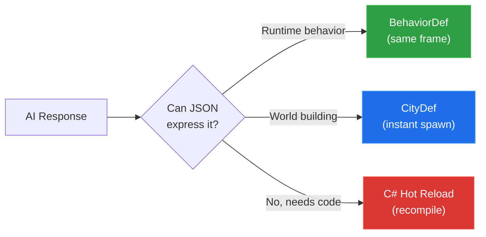

## The OpenClaw Universe 🦞


<p style="font-size: 0.85em; color: #888; font-style: italic; margin-top: 0.5em;">A character, a floor, and a walkie-talkie to God. Everything else came through it.</p>

**I trapped OpenClaw agents inside a 3D western and gave them real jobs. One of them shipped to production. Built in a weekend.**

---

I run engineering and product at a fintech company. My world is APIs, React, deploy-on-push. I'd never touched a game engine. I spent a morning last week hooking up an [OpenClaw 🦞](https://openclaw.ai) agent to our company Slack. It ships mockups, writes specs, deploys apps.

**I gave myself a two-day timebox:** go deep on agents, learn where they break down and how far they can go. So on the weekend, I wanted to push the limits. Naturally, I built them a universe and gave them jobs at Slate.

Last Friday I had zero game development experience. I'd never opened [Unity](https://unity.com). But OpenClaw doesn't care what you know, it cares what you can describe. It was powerful. The agent could scaffold and deploy, but without tight constraints it drifted. It quickly exposed where autonomy still breaks.

By Sunday night I had a 3D western frontier game where AI builds the world around me while I play, NPCs remember who I am across sessions, and a bartender named Mae deployed a Next.js app to Vercel and sent me the live link. In a game. Set in 1887.


That's real. A game NPC scaffolded a Next.js app, pushed it to GitHub, deployed to Vercel, and [handed me the production URL](https://rsvp-app-rho.vercel.app). Here's how.

---

## Why a Game

If you haven't seen [OpenClaw 🦞](https://openclaw.ai) yet: it's an open-source AI agent that hit 200K GitHub stars in 84 days, the fastest in history. 18x faster than Kubernetes. Its creator just got hired by OpenAI. It runs locally, connects to your real tools (GitHub, Vercel, Gmail, 100+ integrations) and actually *does things*. Not chat. Actions. But the interface is always the same: a chat window. That's like giving someone a spaceship and making them drive it with a steering wheel.

What if the agents didn't live in a chat window... what if they lived in a *place*? Full Rick and Morty microverse energy. Except instead of enslaving a civilization to power my car, I'm enslaving AI agents to deploy my Vercel apps. You walk into a saloon. The bartender deploys your app. The blacksmith sets up your CI/CD. They remember your name.


I couldn't find anyone doing this. Every OpenClaw project is another chat integration. Plus I'd never built a game, so might as well learn two things at once.
---

## The Pipe

With OpenClaw, conversation is the medium. That's how you command agents: you talk to them. So the first thing I built wasn't a building or a character. It was a chat window. The pipe.

A WebSocket bridge between [Unity](https://unity.com) and the OpenClaw gateway. In my world, this is a few lines of code. In Unity, there's no SDK. No client library. No package that does this (so [I made one](https://github.com/devinpicciolini/openclaw-worlds) — link at the end). So I built the transport layer from scratch: connection, auth handshake, message framing, streaming response accumulation. I also wrote a JSON parser, all `string.IndexOf` and `StringBuilder`, because I assumed Unity's ecosystem was too hostile for third-party libraries. Turns out Unity ships Newtonsoft.Json. An hour on a parser I didn't need because I didn't know what I didn't know. Welcome to game dev.

When I hit play for the first time, there was almost nothing. A blank character on an empty plane. A camera. A chat window.


Press Tab, and there's Silas, my AI architect agent, connected through the OpenClaw gateway. 84 skills wired up. The full toolbox.


A character, a floor, and a walkie-talkie to God. Everything else came through it.

---

## CityDef: A Protocol for AI World-Building

This is the part I'm most proud of. Not a feature. A protocol.

The problem: how do you let an AI build a 3D world without giving it access to the engine? Silas can't drag objects into a Unity scene. He lives in a terminal. Coming from web, where everything is an API call, this was maddening. So we went around it.

I designed CityDef: a JSON schema that describes everything about a town. Streets, buildings, NPCs, props, all with coordinates and metadata. The AI just produces valid JSON. The engine just parses it. Neither side needs to understand the other.

First thing I typed: "Build me a saloon district with a general store, a jail, and some hitching posts."

Silas generated a CityDef JSON. Unity parsed it and spawned the town in real-time. Buildings materialized around me. Streets appeared under my feet. NPCs started wandering. I didn't place a single object.

<div class="video-container">
  <span class="video-label">▶ Video</span>
  <video src="/images/openclaw-weekend/spawn-town.mp4" autoplay loop muted playsinline controls></video>
  <div class="video-caption">↑ Me typing "build me a town" and buildings, streets, and NPCs spawning around me in real-time</div>
</div>

Then I asked for another town. Then another. Each one different, each one AI-designed on the spot. Soon I had a full frontier, all built through conversation, all persisted to disk, all reloading on next launch.

CityDef isn't a hack. It's a **contract between the AI and the engine.** The AI expresses intent as structured data. The engine interprets it. Neither side needs to understand the other's internals. Any LLM that can produce JSON can build a town. Any engine that can parse JSON can render one. The protocol is the product.

I didn't build a game. I built [the machine that builds the machine](https://d3.harvard.edu/platform-rctom/submission/tesla-building-the-machine-that-builds-the-machine/). The town is a byproduct.

Everything was colored cubes at first. Silas found me the [POLYGON Western pack](https://assetstore.unity.com/packages/3d/environments/historic/polygon-western-pack-art-by-synty-112212) (1,900+ low-poly models), but wiring it up meant fighting Unity's texture atlases, missing material links, and assets that won't import at runtime. My one moment of manual labor the whole weekend.

Not everything was smooth. Silas would confidently generate something completely wrong, I'd push back, he'd overcorrect, I'd push back harder. We went in circles more than once. But we always got there.


---

## The Game Edits Itself

An NPC generated me a Google Slides presentation in the game chat. I tried to click the link. Just text. So I told Silas: "Add hyperlink support to the chat." He found the rendering code, added URL detection with regex, made them clickable, styled them blue. I clicked the link. It opened in my browser.


"The chat window is too small." Fixed. "Add a minimap." Fixed. "NPCs should face you when you talk to them." Fixed. "Make it foggy." Instant.

The AI wasn't just building the world. It was editing the game itself. And the reason it worked is because I designed every protocol to prefer data over code:



**BehaviorDef** handles weather, lighting, physics, particles, anything expressible as JSON. Same frame. No compilation. **CityDef** handles world building: streets, buildings, interiors, NPCs, props. Also JSON, also instant. And when JSON can't express it? **C# Hot Reload.** Silas writes real C# to a Generated folder, Unity recompiles live, and suddenly the game has new physics, new mechanics, new systems. The agent isn't just decorating the world. He's rewriting the rules of the universe he's standing in, while I'm standing in it too.

Three protocols. JSON first, recompile last. But the recompile is where it gets wild, because that means the AI can change *anything*. Gravity, collision, NPC behavior, camera systems. Things I never designed for. The game becomes a living codebase that edits itself through conversation.

<p style="font-size: 0.85em; color: #888; font-style: italic; margin-top: 1.5em;">If this reads like a web developer who just discovered hot-reloading scripts and thinks they invented React, yeah, fair. I'm sure game devs have been doing this stuff, but to me it was all new!</p>

---

## Breaking the Fourth Wall

This is where it gets existential.

Every NPC can be backed by a real OpenClaw agent. Not a chatbot, not a dialogue tree. A full agent with pre-authenticated access to real tools. Walk up to Mae the bartender and press E. She has her own personality, her own memory, and real capabilities: GitHub, Vercel, Google Workspace. The same markdown skill files that power any OpenClaw agent, just symlinked into an NPC's workspace.


Ask Mae to build you a landing page. She'll scaffold a Next.js app, create a GitHub repo, push the code, deploy to Vercel, and [hand you the production URL](https://rsvp-app-rho.vercel.app). In character. As a bartender in 1887. Ask Jeb the blacksmith to set up CI/CD. He'll actually do it. Ask Sheriff Buck to research a competitor and he'll come back with a report. Edith will draft emails and read your Gmail.


These aren't mocked responses. You're standing in a saloon getting a Vercel link from a woman in a bonnet, and the link works. A Notion doc, a Google Slides deck, or even a full PRD sent straight to your email:


And they remember. Each agent writes to a memory file after every conversation. Tell Mae your name on Monday. On Thursday she greets you by name and asks about the project you mentioned. The personality directives encourage real behavior: they lie, refuse service, hold grudges, play favorites. They're not trying to be helpful. They're trying to be *real*.

---

## Let Them Die


This is the architectural decision I got the most wrong before I got it right.

You can't spin up hundreds of Claude sessions on a laptop. Named NPCs (Mae, Sheriff Buck, Jeb) get their own dedicated agent with their own workspace and memory. Random townfolk share a single rotating slot that gets re-skinned with a new personality each time.

My first instinct was to keep agents alive. Long-running sessions, persistent connections, idling in memory. It doesn't scale. Five agents and my machine was crawling.

The answer was the opposite: let them die. Walk up, agent spins up. Walk away, agent winds down. The process dies. But the memory file stays. Next time, a fresh agent reads it and picks up the thread.

<div class="video-container">
  <span class="video-label">▶ Video</span>
  <video src="/images/openclaw-weekend/spinup-agent.mp4" autoplay loop muted playsinline controls></video>
  <div class="video-caption">↑ Walking up to an NPC, agent spins up on approach, loads memory, ready to work</div>
</div>

You ask Mae to deploy an app, walk across town, talk to someone else, and when you come back, the Vercel link is waiting. To the player, Mae never left. She was always here, cleaning glasses behind the bar.

In reality, the Mae you talked to yesterday is dead. This is a new Mae wearing the old one's memories. Functionally? No difference. And that's the point.


Ephemeral processes, persistent memory. Kill the agent, keep the soul. And it turns out this isn't just a game pattern. It's how you'd scale agents anywhere. An office sim, a space station, a factory floor. Anywhere agents live in space, this is the move: spawn cheap, remember everything, die gracefully.

---

## What I Learned

I kept accidentally reinventing things. Distance-based object streaming? That's "LOD with hysteresis," been around since the 90s. Routing fifteen agents through one WebSocket with session keys? "Opcode dispatch," straight out of Quake. Game devs would roll their eyes. But the two worlds are way closer than I realized.

The other thing: LLMs are sloppy. Wrong field names, buildings inside mountains. So we built a validation layer between AI output and the engine. Let the AI be sloppy. Your engine should be strict.

---

47 source files. ~15,000 lines of C#. 1,900+ 3D models. 15 agents. Three protocols. Zero game dev experience going in.

I didn't build a game and add AI. I connected to [OpenClaw 🦞](https://openclaw.ai) and a game built itself around me.

We keep putting agents in chat windows. But agents don't belong in windows. They belong in worlds. Give them a place to stand, tools to use, and memories to carry, and they stop being assistants. They become coworkers. Weird, sloppy, occasionally brilliant coworkers who live in 1887 and deploy to Vercel.

The frontier is open.

So I extracted it. The gateway layer, CityDef, BehaviorDef, the agent pool, NPC memory — all of it is a Unity SDK now. Three lines and you're playing god:

```csharp
// Create a being
var npc = new GameObject("Mae");
npc.AddComponent<NPCData>().Init(
    "Mae", "What'll it be, stranger?",
    new[] { "Drinks", "Deploy apps", "Town gossip" },
    isPersistent: true);  // she'll remember you

// Give her a soul
AgentPool.Instance.AcquireAgent(npcData,
    onReady: (agentId) => { /* she's alive */ },
    onError: (err)     => { /* she's not */ });
```

<div style="margin: 2em 0; padding: 1.5em 2em; background: #1c2128; border: 2px solid rgba(88, 166, 255, 0.4); border-radius: 10px; box-shadow: 0 0 0 1px rgba(88, 166, 255, 0.1), 0 8px 24px rgba(0,0,0,0.4), 0 0 40px rgba(88,166,255,0.06); text-align: center;">
  <p style="font-size: 1.3em; font-weight: 700; margin: 0 0 0.4em 0; color: #ededed;">🦞 OpenClaw Worlds Unity SDK</p>
  <p style="font-size: 1em; color: #adbac7; margin: 0 0 1em 0;">Drop OpenClaw agents into any Unity project. They build worlds, do real work, and remember everything.</p>
  <a href="https://github.com/devinpicciolini/openclaw-worlds" style="display: inline-block; padding: 0.6em 1.8em; background: rgba(88, 166, 255, 0.9); color: #fff; border-radius: 6px; font-weight: 600; font-size: 0.95em; text-decoration: none; letter-spacing: 0.02em;">View on GitHub →</a>
</div>

---

*[Devin](https://twitter.com/devinpicciolini)*
